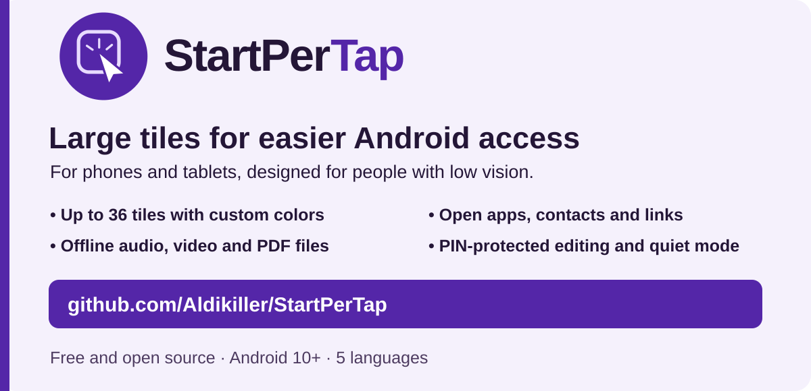
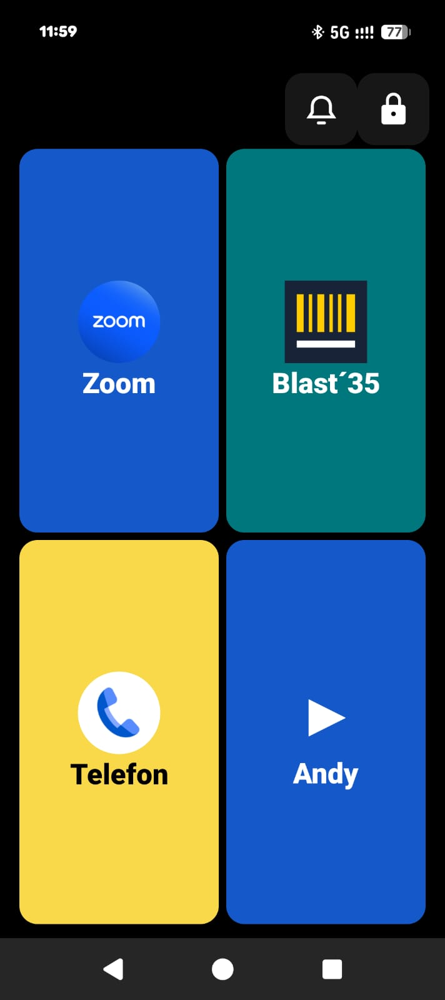
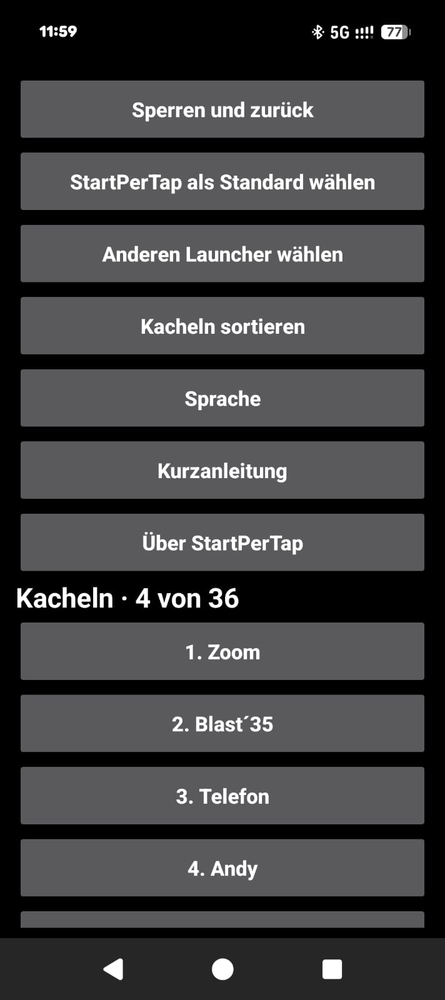
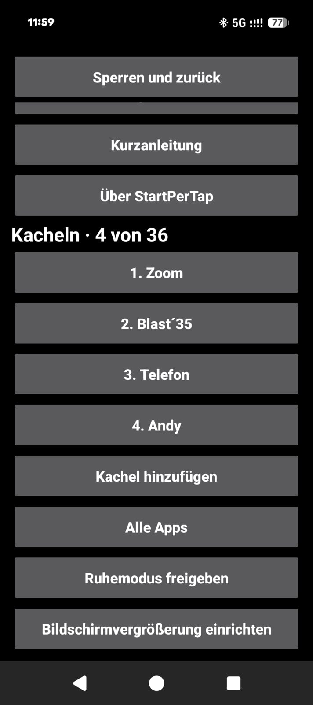

# StartPerTap

**English** · [Deutsch](docs/README.de.md) · [Español](docs/README.es.md) · [Français](docs/README.fr.md) · [Українська](docs/README.uk.md)

Free Android launcher with large tiles for people with low vision.

[](https://github.com/Aldikiller/StartPerTap/releases/tag/v0.17)

## Download

[StartPerTap 0.17 (APK)](https://github.com/Aldikiller/StartPerTap/releases/download/v0.17/StartPerTap-0.17.apk)

Install the APK on Android 10 or later. Open StartPerTap and use **Lock → PIN** to configure your tiles. To replace your home screen, choose **Set StartPerTap as default** in the settings.


## Watch on YouTube

[English](https://youtu.be/7284c3nULzI) · [Deutsch](https://youtu.be/8ppZHYamE14) · [Español](https://youtu.be/V37xc_blXws) · [Français](https://youtu.be/0t8F8R3NWXQ) · [Українська](https://youtu.be/AOm8y0MFCAM)

The videos show concept mockups. The images below are screenshots from the app.

## Screenshots from Google Pixel

  

[About StartPerTap 0.16](docs/StartPerTap-Pixel-Info.jpg)

## Features

- Up to 36 tiles for apps, contacts and links. Swipe between pages and reorder tiles in the settings.
- Customize tile colors and change the order across pages.
- Open Zoom meetings, WhatsApp call links and websites from tiles.
- Open files stored on your device offline, including audio, video and PDFs. Android uses a compatible installed app.
- Use a PIN to prevent accidental edits and reset it after two confirmations.
- Switch Android’s default launcher and open the system settings for screen magnification.
- Turn on quiet mode from the home screen after granting Android permission.

## Build from source

With JDK 17+, Android SDK Platform 35, Windows Build Tools and Android command-line tools installed, run the PowerShell command below. The build script creates a local signing key for testing.

```powershell
.\build.ps1 -Sdk 'C:\Android\Sdk' -Jdk 'C:\Java\jdk' -BuildTools '35.0.0' -OutputApk 'C:\Temp\StartPerTap.apk'
```

[MIT](LICENSE) · Aldikiller
