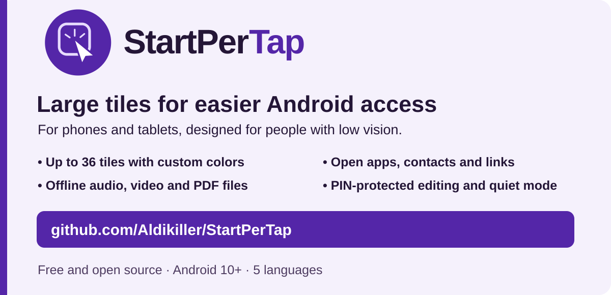
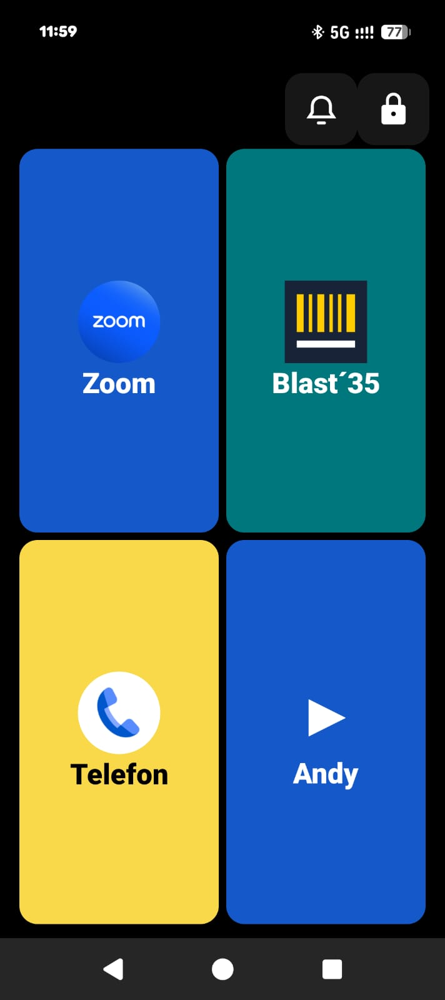
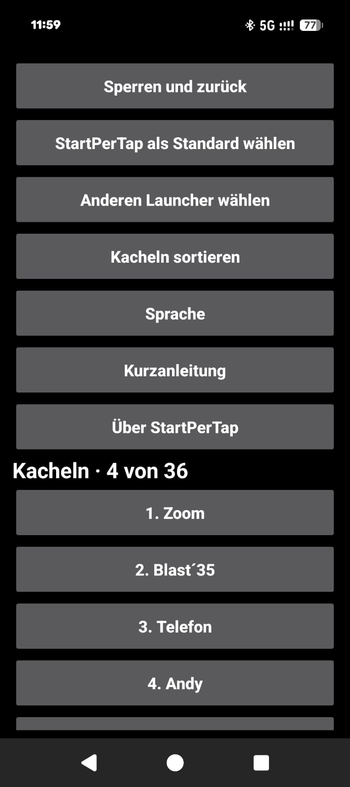
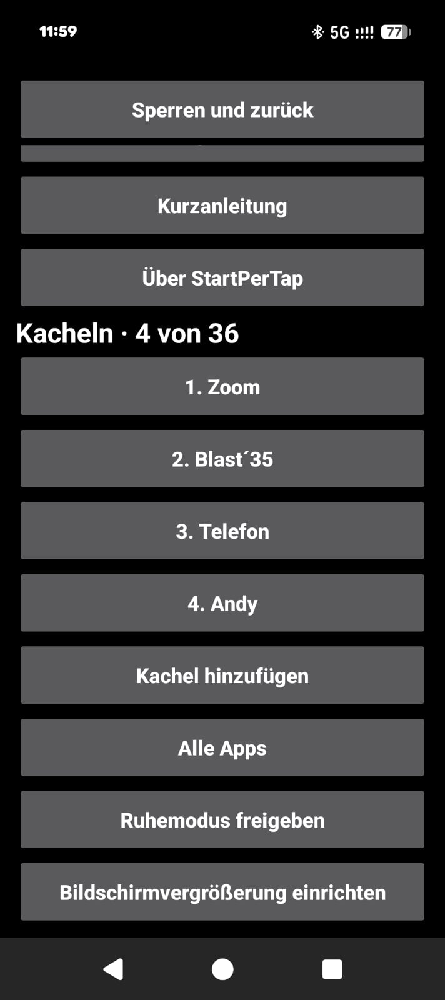

# StartPerTap

[English](../README.md) · **Deutsch** · [Español](README.es.md) · [Français](README.fr.md) · [Українська](README.uk.md)

Kostenloser Android-Launcher mit großen Kacheln für Menschen mit Sehbeeinträchtigung.

[](https://github.com/Aldikiller/StartPerTap/releases/tag/v0.17)

## Download

[StartPerTap 0.17 (APK)](https://github.com/Aldikiller/StartPerTap/releases/download/v0.17/StartPerTap-0.17.apk)

Installiere die APK auf Android 10 oder neuer. Öffne StartPerTap und richte deine Kacheln unter **Schloss → PIN** ein. Wähle in den Einstellungen **StartPerTap als Standard wählen**, um die Android-Startseite zu ersetzen.


## YouTube-Videos

[English](https://youtu.be/7284c3nULzI) · [Deutsch](https://youtu.be/8ppZHYamE14) · [Español](https://youtu.be/V37xc_blXws) · [Français](https://youtu.be/0t8F8R3NWXQ) · [Українська](https://youtu.be/AOm8y0MFCAM)

Die Videos zeigen Entwürfe. Die Bilder unten sind echte App-Aufnahmen.

## Screenshots vom Google Pixel

  

[Über StartPerTap 0.16](StartPerTap-Pixel-Info.jpg)

## Funktionen

- Bis zu 36 Kacheln für Apps, Kontakte und Links. Wische zwischen den Seiten und sortiere die Kacheln in den Einstellungen.
- Wähle eigene Kachelfarben und ändere die Reihenfolge über mehrere Seiten hinweg.
- Öffne Zoom-Meetings, WhatsApp-Anruflinks und Webseiten über Kacheln.
- Öffne lokal gespeicherte Audio-, Video- und PDF-Dateien offline in einer passenden installierten Android-App.
- Schütze die Bearbeitung mit einer PIN. Du kannst sie nach zwei Bestätigungen zurücksetzen.
- Wechsle die Android-Startseite und öffne die Systemeinstellungen für die Bildschirmvergrößerung.
- Schalte den Ruhemodus nach Android-Freigabe über die Glocke auf der Startseite ein.

## Aus dem Quellcode bauen

Installiere JDK 17+, Android SDK Platform 35, die Windows Build Tools und die Android-Kommandozeilenwerkzeuge. Führe dann den PowerShell-Befehl aus. Das Buildskript erstellt einen lokalen Schlüssel für Testsignaturen.

```powershell
.\build.ps1 -Sdk 'C:\Android\Sdk' -Jdk 'C:\Java\jdk' -BuildTools '35.0.0' -OutputApk 'C:\Temp\StartPerTap.apk'
```

[MIT](../LICENSE) · Aldikiller
