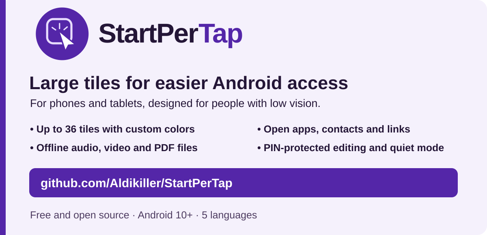
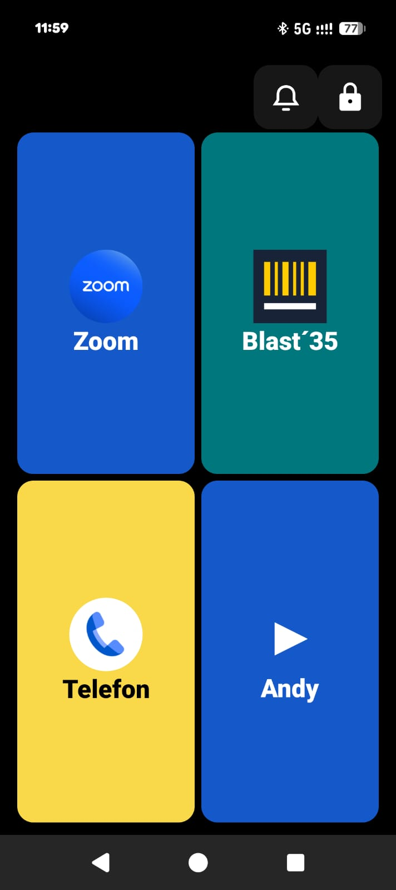
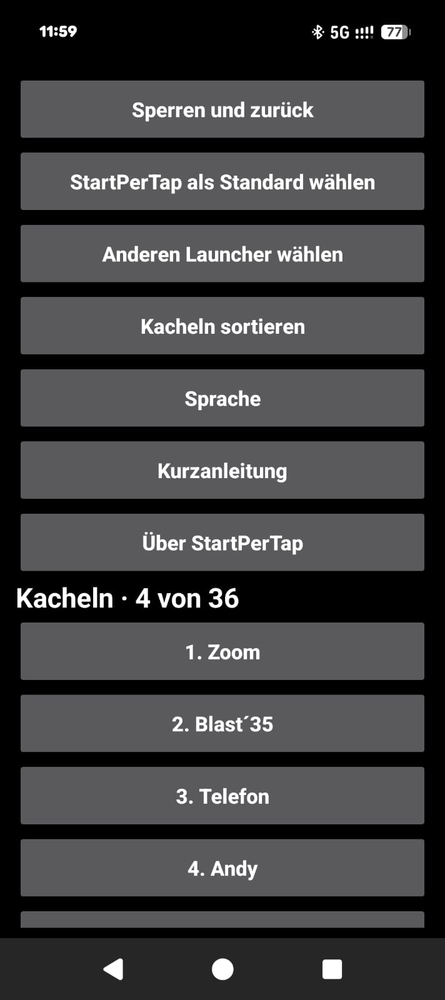
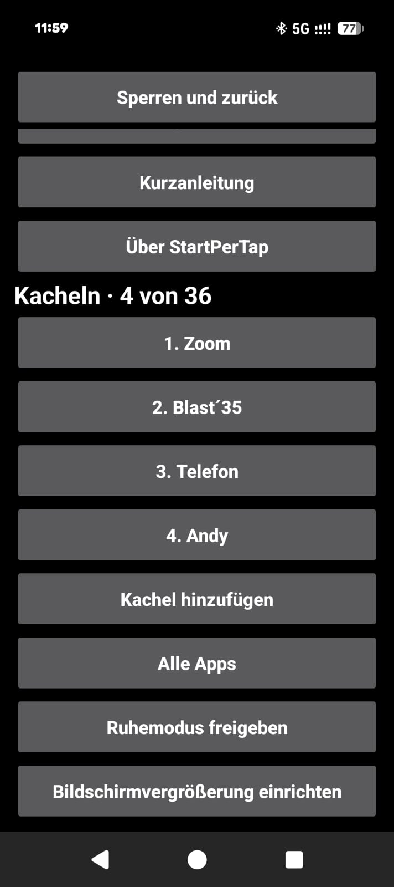

# StartPerTap

[English](../README.md) · [Deutsch](README.de.md) · **Español** · [Français](README.fr.md) · [Українська](README.uk.md)

Lanzador gratuito para Android con fichas grandes para personas con baja visión.

[](https://github.com/Aldikiller/StartPerTap/releases/tag/v0.17)

## Descarga

[StartPerTap 0.17 (APK)](https://github.com/Aldikiller/StartPerTap/releases/download/v0.17/StartPerTap-0.17.apk)

Instala el APK en Android 10 o posterior. Abre StartPerTap y configura tus fichas en **Candado → PIN**. Para cambiar la pantalla de inicio, elige **Elegir StartPerTap por defecto** en los ajustes.


## Vídeos en YouTube

[English](https://youtu.be/7284c3nULzI) · [Deutsch](https://youtu.be/8ppZHYamE14) · [Español](https://youtu.be/V37xc_blXws) · [Français](https://youtu.be/0t8F8R3NWXQ) · [Українська](https://youtu.be/AOm8y0MFCAM)

Los vídeos muestran bocetos. Las imágenes de abajo son capturas reales de la aplicación.

## Capturas de Google Pixel

  

[Acerca de StartPerTap 0.16](StartPerTap-Pixel-Info.jpg)

## Funciones

- Hasta 36 fichas para aplicaciones, contactos y enlaces. Desliza para cambiar de página y ordena las fichas en los ajustes.
- Personaliza los colores y ordena las fichas entre páginas.
- Abre reuniones de Zoom, enlaces de llamadas de WhatsApp y sitios web desde las fichas.
- Abre archivos locales de audio, vídeo y PDF sin conexión mediante una aplicación compatible.
- Protege la edición con un PIN que puedes restablecer tras dos confirmaciones.
- Cambia el lanzador predeterminado y abre los ajustes de ampliación de Android.
- Activa el modo silencio desde la pantalla de inicio tras conceder el permiso de Android.

## Compilar desde el código fuente

Instala JDK 17+, Android SDK Platform 35, las Build Tools para Windows y las herramientas de línea de comandos de Android. Ejecuta el comando de PowerShell. El script crea una clave local para las firmas de prueba.

```powershell
.\build.ps1 -Sdk 'C:\Android\Sdk' -Jdk 'C:\Java\jdk' -BuildTools '35.0.0' -OutputApk 'C:\Temp\StartPerTap.apk'
```

[MIT](../LICENSE) · Aldikiller
