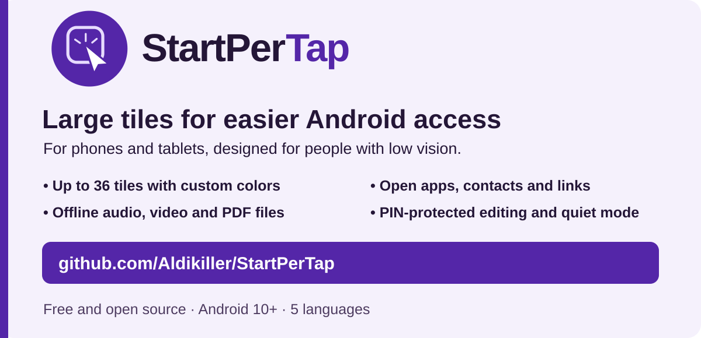
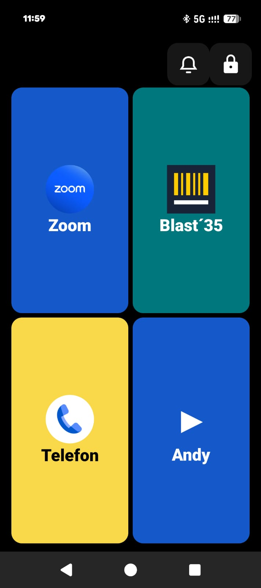
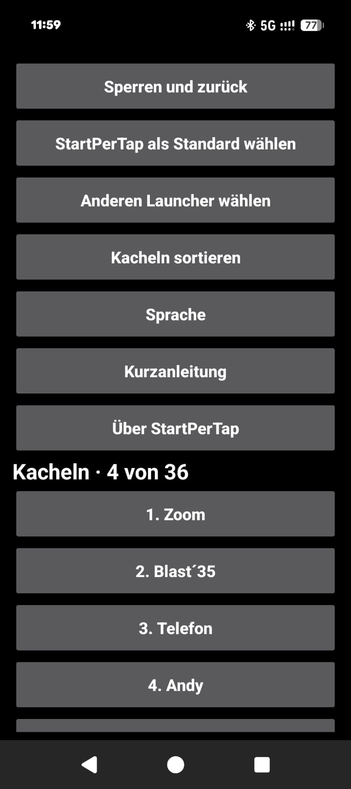
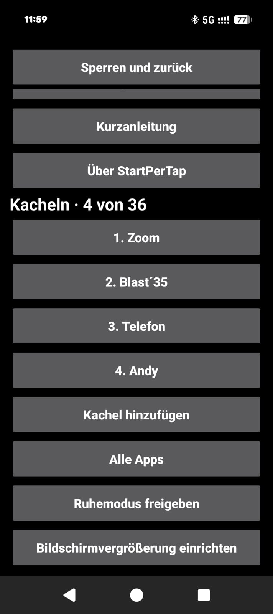

# StartPerTap

[English](../README.md) · [Deutsch](README.de.md) · [Español](README.es.md) · **Français** · [Українська](README.uk.md)

Lanceur Android gratuit avec de grandes tuiles pour les personnes malvoyantes.

[](https://github.com/Aldikiller/StartPerTap/releases/tag/v0.17)

## Téléchargement

[StartPerTap 0.17 (APK)](https://github.com/Aldikiller/StartPerTap/releases/download/v0.17/StartPerTap-0.17.apk)

Installez l’APK sur Android 10 ou une version ultérieure. Ouvrez StartPerTap et configurez vos tuiles via **Cadenas → Code PIN**. Dans les paramètres, choisissez **Choisir StartPerTap par défaut** pour changer d’écran d’accueil.


## Vidéos sur YouTube

[English](https://youtu.be/7284c3nULzI) · [Deutsch](https://youtu.be/8ppZHYamE14) · [Español](https://youtu.be/V37xc_blXws) · [Français](https://youtu.be/0t8F8R3NWXQ) · [Українська](https://youtu.be/AOm8y0MFCAM)

Les vidéos présentent des maquettes. Les images ci-dessous sont de vraies captures de l’application.

## Captures sur Google Pixel

  

[À propos de StartPerTap 0.16](StartPerTap-Pixel-Info.jpg)

## Fonctionnalités

- Jusqu’à 36 tuiles pour les applications, contacts et liens. Balayez pour changer de page et réorganisez les tuiles dans les paramètres.
- Personnalisez les couleurs et réorganisez les tuiles entre les pages.
- Ouvrez les réunions Zoom, les liens d’appel WhatsApp et les sites web depuis les tuiles.
- Ouvrez hors ligne les fichiers audio, vidéo et PDF stockés sur l’appareil dans une application compatible.
- Protégez les modifications avec un code PIN réinitialisable après deux confirmations.
- Changez le lanceur par défaut et ouvrez les réglages de grossissement d’Android.
- Activez le mode silencieux depuis l’accueil après autorisation dans Android.

## Compiler depuis le code source

Installez JDK 17+, Android SDK Platform 35, les Build Tools pour Windows et les outils en ligne de commande Android. Exécutez la commande PowerShell. Le script crée une clé locale pour les signatures de test.

```powershell
.\build.ps1 -Sdk 'C:\Android\Sdk' -Jdk 'C:\Java\jdk' -BuildTools '35.0.0' -OutputApk 'C:\Temp\StartPerTap.apk'
```

[MIT](../LICENSE) · Aldikiller
