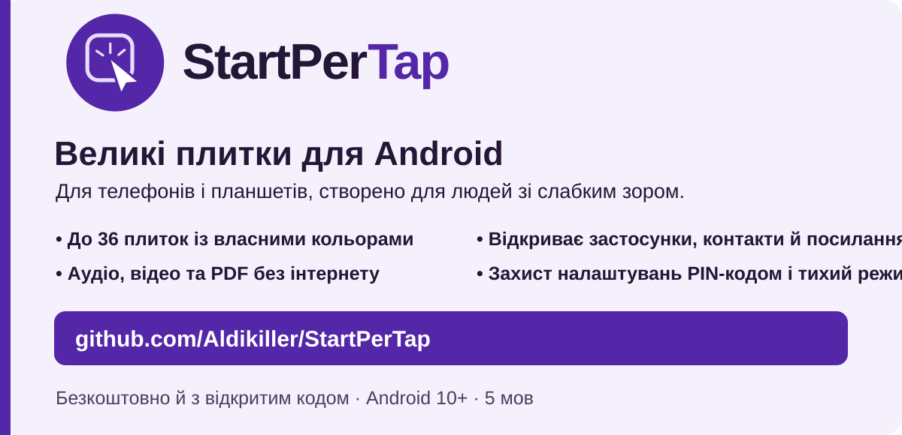
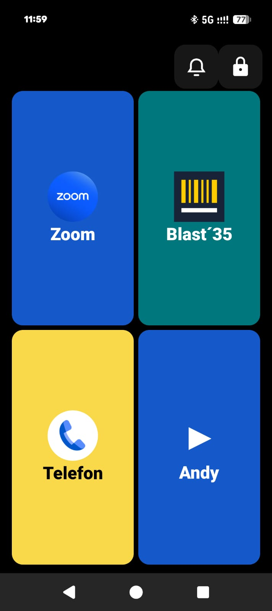
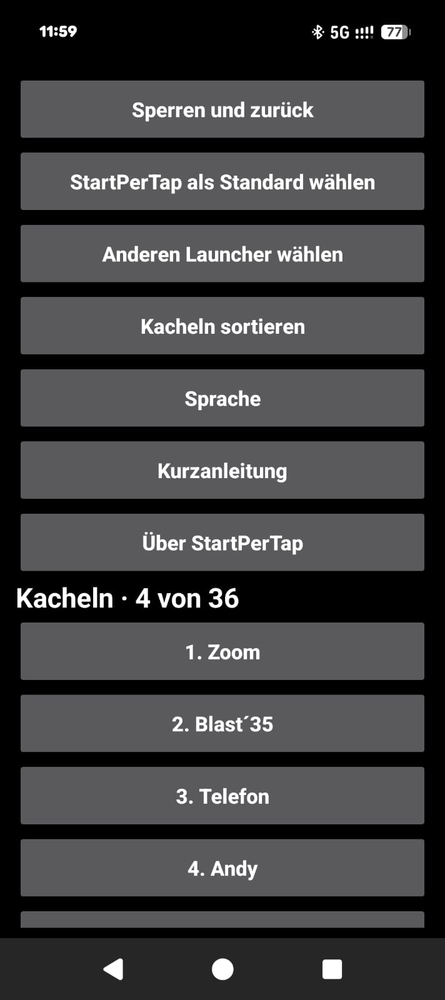
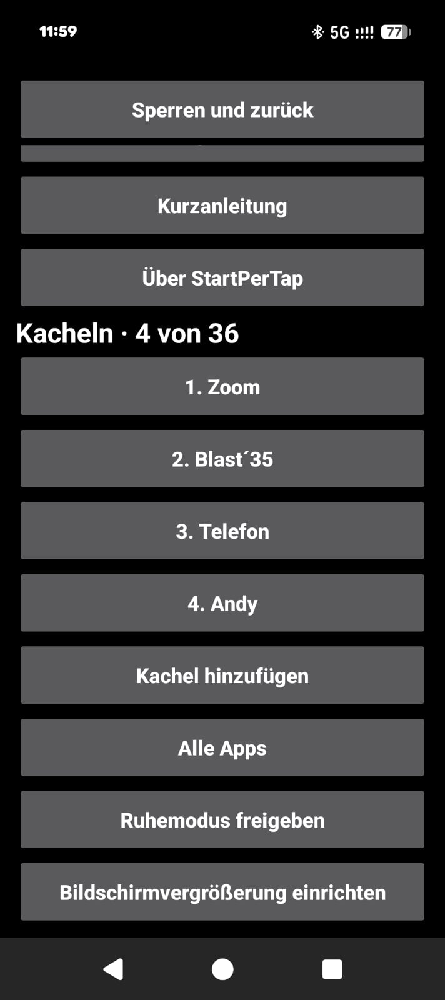

# StartPerTap

[English](../README.md) · [Deutsch](README.de.md) · [Español](README.es.md) · [Français](README.fr.md) · **Українська**

Безкоштовний лаунчер Android із великими плитками для людей зі слабким зором.

[](https://github.com/Aldikiller/StartPerTap/releases/tag/v0.17)

## Завантаження

[StartPerTap 0.17 (APK)](https://github.com/Aldikiller/StartPerTap/releases/download/v0.17/StartPerTap-0.17.apk)

Установіть APK на Android 10 або новішу версію. Відкрийте StartPerTap і налаштуйте плитки через **Замок → PIN-код**. У налаштуваннях виберіть **Вибрати StartPerTap за замовчуванням**, щоб змінити головний екран.


## Відео на YouTube

[English](https://youtu.be/7284c3nULzI) · [Deutsch](https://youtu.be/8ppZHYamE14) · [Español](https://youtu.be/V37xc_blXws) · [Français](https://youtu.be/0t8F8R3NWXQ) · [Українська](https://youtu.be/AOm8y0MFCAM)

У відео показано макети. Нижче наведено справжні знімки екрана програми.

## Знімки екрана з Google Pixel

  

[Про StartPerTap 0.16](StartPerTap-Pixel-Info.jpg)

## Можливості

- До 36 плиток для програм, контактів і посилань. Гортайте сторінки та змінюйте порядок плиток у налаштуваннях.
- Вибирайте кольори та змінюйте порядок плиток між сторінками.
- Відкривайте зустрічі Zoom, посилання на виклики WhatsApp і вебсайти з плиток.
- Відкривайте локальні аудіо-, відео- та PDF-файли без інтернету в сумісній програмі.
- Захистіть редагування PIN-кодом, який можна скинути після двох підтверджень.
- Змінюйте стандартний лаунчер і відкривайте налаштування збільшення екрана Android.
- Увімкніть тихий режим із головного екрана після надання дозволу Android.

## Збирання з вихідного коду

Установіть JDK 17+, Android SDK Platform 35, Build Tools для Windows та інструменти командного рядка Android. Виконайте команду PowerShell. Скрипт створить локальний ключ для тестових підписів.

```powershell
.\build.ps1 -Sdk 'C:\Android\Sdk' -Jdk 'C:\Java\jdk' -BuildTools '35.0.0' -OutputApk 'C:\Temp\StartPerTap.apk'
```

[MIT](../LICENSE) · Aldikiller
